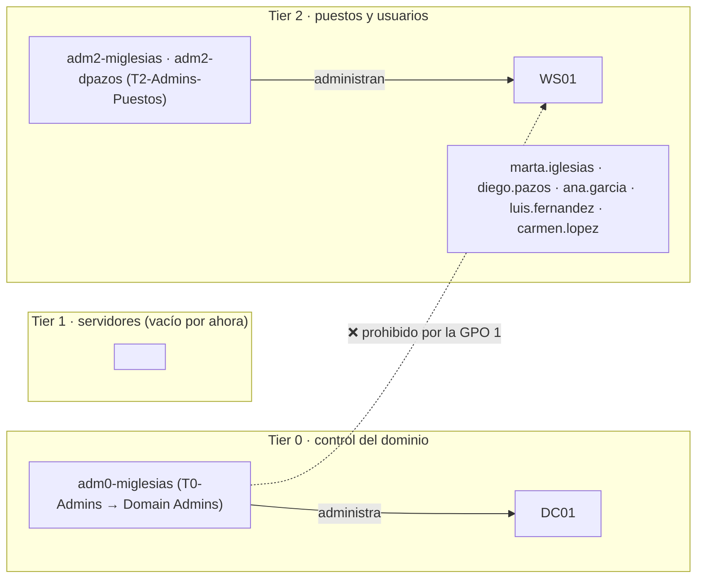

# Laboratorio de Active Directory · Brétema Componentes S.L.

> Proyecto personal: simulo el despliegue real de un Active Directory, con separación por niveles,
> en una empresa ficticia. Etapa **E1** de mi laboratorio de identidad (la E2 lo conectará con Entra ID).
> Estado: **E1 cerrada el 2026-10-04**.

## 1. Qué es esto

**Brétema Componentes S.L.** es un proveedor de piezas de automoción de segundo nivel —vende a las
empresas que suministran a las fábricas de coches—, con **unas 40 personas en Vigo**.

Sus **clientes, fabricantes alemanes, le exigen la certificación TISAX** de seguridad de la
información, y eso obliga a **controlar el acceso privilegiado**: quién puede administrar qué, y
desde dónde. Para eso monto su directorio.

| Pieza | Valor |
|---|---|
| Dominio | `corp.lab` (nombre corto `CORP`) |
| Sufijo de los usuarios (UPN) | `bretemacomp.com` (dominio registrado) |
| DC01 | Windows Server 2025 · `192.168.10.10` · controlador de dominio y DNS |
| WS01 | Windows 11 Enterprise · `192.168.10.20` · puesto de un empleado |
| Red | Red NAT de VirtualBox `192.168.10.0/24`, sin DHCP |

## 2. El diseño

Tres niveles (*tier model*): **Tier 0** es lo que controla todo el dominio (el DC y sus
administradores), **Tier 1** los servidores y **Tier 2** los puestos y los usuarios.
**La regla: una cuenta de un nivel nunca inicia sesión en una máquina de un nivel inferior**, porque
dejaría allí sus credenciales y quien controlase esa máquina se las llevaría.



**Las unidades organizativas (OU):**
```
corp.lab
├── Domain Controllers      ← DC01 (Tier 0 por definición)
└── Bretema
    ├── Tier0 ─ Cuentas · Grupos
    ├── Tier1 ─ Cuentas · Grupos · Servidores
    └── Tier2 ─ Cuentas · Grupos · Equipos · Usuarios
```

**OU frente a grupo:** la OU decide **qué normas te tocan** (qué GPO se te aplican); el grupo decide
**qué permisos tienes**. Por eso las reglas van a las OU y los accesos, a los grupos.

**Las personas:**

| Persona | Cuenta normal | Admin de puestos (T2) | Admin de dominio (T0) |
|---|---|---|---|
| Marta Iglesias, responsable de IT | `marta.iglesias` | `adm2-miglesias` | `adm0-miglesias` |
| Diego Pazos, técnico de soporte | `diego.pazos` | `adm2-dpazos` | ❌ no tiene |
| Ana García · Luis Fernández · Carmen López | sus cuentas | — | — |

- **Marta tiene una cuenta por nivel** porque cada una solo se usa en el suyo. Su cuenta normal es la
  que lee el correo y navega, la más expuesta al phishing: si fuera administradora del dominio, un
  solo clic regalaría la empresa.
- **Diego no tiene Tier 0** por **privilegio mínimo**: su trabajo no lo necesita, y cada cuenta de
  Tier 0 de más es una puerta más a todo el dominio.
- **Grupos:** `T0-Admins` (dentro de *Domain Admins*) · `T2-Admins-Puestos` (administradores locales
  de WS01) · `GG-Administracion`, `GG-Ingenieria`, `GG-Produccion` (accesos por departamento).

## 3. Las reglas (GPO) y cómo comprobé que funcionan

**GPO 1 · Tier 0 no entra en los puestos.** Enlazada a la OU `Tier2\Equipos`: prohíbe a *Domain
Admins*, *Enterprise Admins* y *Schema Admins* iniciar sesión **en local** y **por escritorio
remoto** en los equipos de Tier 2. Va en `Equipos` porque es una norma sobre **en qué máquina** se
puede entrar.
*Prueba:* antes de aplicarla predije el resultado de 4 cuentas y acerté las 4. `CORP\Administrator`
y `adm0-miglesias` ❌ —esta última solo es Domain Admin por anidamiento, a través de `T0-Admins`, y
aun así queda bloqueada: el token de inicio de sesión lleva todos los grupos, también los anidados—;
`adm2-dpazos` y `ana.garcia` ✅.

**GPO 2 · contraseñas.** Política del dominio: **mínimo 12 caracteres**. Y una **PSO** (política de
contraseñas de grano fino) para `T0-Admins` y *Domain Admins*: **mínimo 20**, historial de 24, sin
caducidad y bloqueo a los 10 intentos. Una GPO aplica la misma política a todo el dominio; para
exigir más a un grupo hace falta una PSO.
*Prueba:* `Get-ADUserResultantPasswordPolicy adm0-miglesias` devuelve la PSO (para `ana.garcia`, nada:
le toca la del dominio). Subir la política **no** obligó a Ana a cambiar su contraseña antigua —AD
solo guarda la huella, no puede medir la contraseña vieja—, y un *reset* a 10 caracteres **fue
rechazado**. La política se comprueba solo al poner una contraseña.

**GPO 3 · auditoría avanzada.** Enlazada a la OU `Domain Controllers`: registra validación de
credenciales, Kerberos, inicios de sesión, cambios en cuentas y grupos, y cambios de directiva.
Tres partes: las subcategorías, forzar que manden sobre la auditoría antigua, y subir el registro
de seguridad a 1 GB para que no se borre lo antiguo en horas.
*Prueba:* al crear una cuenta de prueba aparece el evento **4720** con quién, cuándo, qué cuenta y
desde qué sesión. (Crear cuentas es una técnica de persistencia, MITRE T1136: este evento es cómo se
detecta.)

## 4. Antes y después (PingCastle)

Nota de riesgo, de 0 (mejor) a 100. La global es la peor de las cuatro categorías.

| Categoría | 26-09 (base) | 03-10 (tras C4 y GPO) | 04-10 (tras arreglar) |
|---|---|---|---|
| Stale Objects | 30 | 30 | 30 |
| Privileged Accounts | 40 | **50** ⬆️ | **20** ⬇️ |
| Trusts | 0 | 0 | 0 |
| Anomalies | 60 | **50** ⬇️ | 50 |
| **Global** | **60** | **50** | **50** |

- **Segunda pasada:** desaparece `A-MinPwdLen` (lo arregló la GPO 2) y **aparece
  `P-ProtectedUsers`**, que salta con **2 o más** cuentas privilegiadas fuera del grupo *Protected
  Users*: al crear `adm0-miglesias` pasé de 1 a 2. **Al endurecer creé más cuentas con poder, y con
  ellas más superficie que proteger.**
- **Tercera pasada:** `adm0-miglesias` a *Protected Users* (sigue entrando en DC01, ahora con su UPN)
  y `Administrator` marcada como no delegable → **desaparecen `P-ProtectedUsers` y `P-Delegated`:
  Privileged Accounts baja de 50 a 20.** `Administrator` queda fuera de *Protected Users* a propósito,
  como cuenta de emergencia.
- 🔑 **Y aun así la nota global no se movió (50)**, porque **la global es la PEOR categoría**, y la
  peor es Anomalies. Una mejora real de 30 puntos no se ve en el número de arriba. ⇒ Para bajar la
  global hay que atacar la categoría peor, no la que más se ha trabajado.
- `A-AuditDC` sigue: la lista de referencia de PingCastle (adsecurity.org) pedía **8** subcategorías
  que mi GPO 3 no tenía; añadí 3 y quedan 5 (Kerberos Service Ticket Operations, Logoff, Process
  Creation, Security System Extension, Sensitive Privilege Use).
- **Lo que queda en Anomalies (50):** copia de seguridad (15), LAPS (15), auditoría (10), rutas de
  SYSVOL sin blindar (5) y un solo DC (5, riesgo aceptado).

## 5. Lo que se torció y cómo lo arreglé

1. **Errata en el sufijo UPN** (`bretemacorp.com` en vez de `bretemacomp.com`). La detecté **antes**
   de crear usuarios, comprobando con `Get-ADForest`.
2. **El reloj de DC01 iba mal**, primero adelantado y luego atrasado 13,6 h. Eran dos causas: la zona
   horaria de California que trae la ISO en inglés, y una VM reanudada desde estado guardado. Lo
   arreglé con la zona correcta y sincronización con un NTP externo. El DC es la fuente de hora del
   dominio, y con más de 5 minutos de diferencia Kerberos falla.
3. **Disco del portátil lleno** (`VERR_DISK_FULL`): WS01 se había creado en la carpeta por defecto,
   en el SSD pequeño. La moví al disco grande con `VBoxManage movevm`.
4. **DC01 volvió a una instantánea antigua** al apagarla, y perdió la cuenta de WS01 y el arreglo del
   reloj: WS01 ya no podía iniciar sesiones de dominio. Lo arreglé creando antes la cuenta del
   equipo en su OU y reparando la relación de confianza con `Test-ComputerSecureChannel -Repair`.

## 6. Lo que este laboratorio NO cubre

- **Excepciones de contraseñas, aceptadas a conciencia** frente a NIST SP 800-63B-4: mínimo 12 en
  vez de 15; caducidad activa (NIST la prohíbe); sin bloqueo para usuarios normales; y la
  complejidad activada, que NIST prohíbe, hasta tener una lista de contraseñas filtradas (E2).
- **La GPO 1 cierra 2 de las 5 formas de iniciar sesión** (local y escritorio remoto). En producción
  se deniegan también red, tareas programadas y servicios, y también Tier 1 en los puestos.
- Sin LAPS, sin copia de seguridad del dominio, un solo DC, NTLMv1 permitido y cualquier usuario
  puede unir 10 equipos (`MachineAccountQuota`).
- **El dominio se llama `corp.lab`** porque se creó antes de diseñar la empresa. En un despliegue
  real usaría un subdominio del dominio registrado (`ad.bretemacomp.com`, nombre corto `BRETEMA`);
  los usuarios ya usan la identidad buena gracias al sufijo `bretemacomp.com`.
